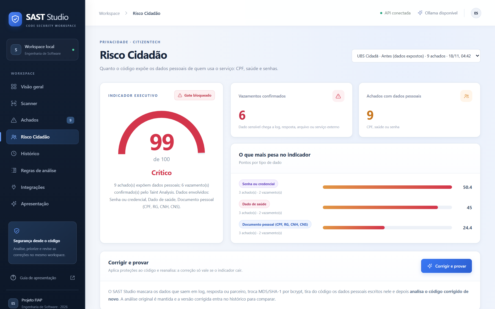
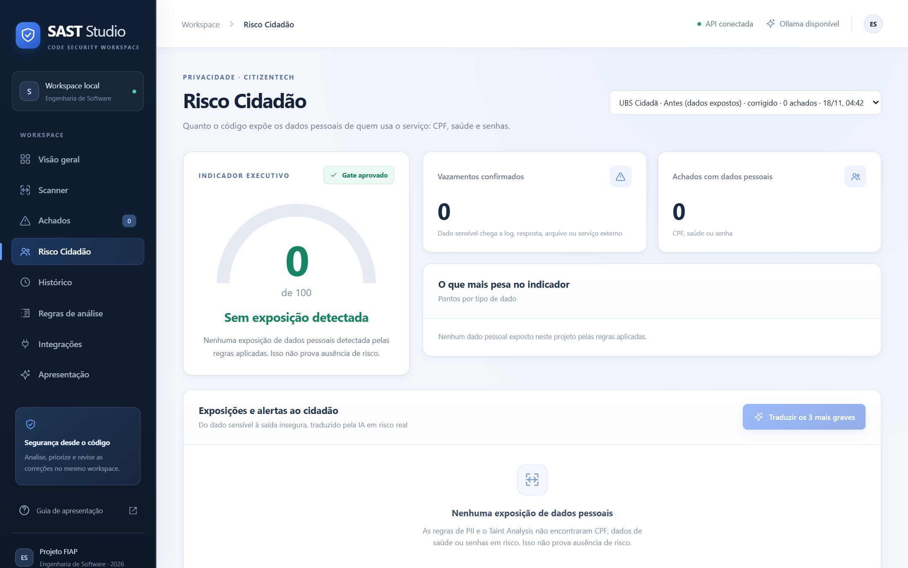
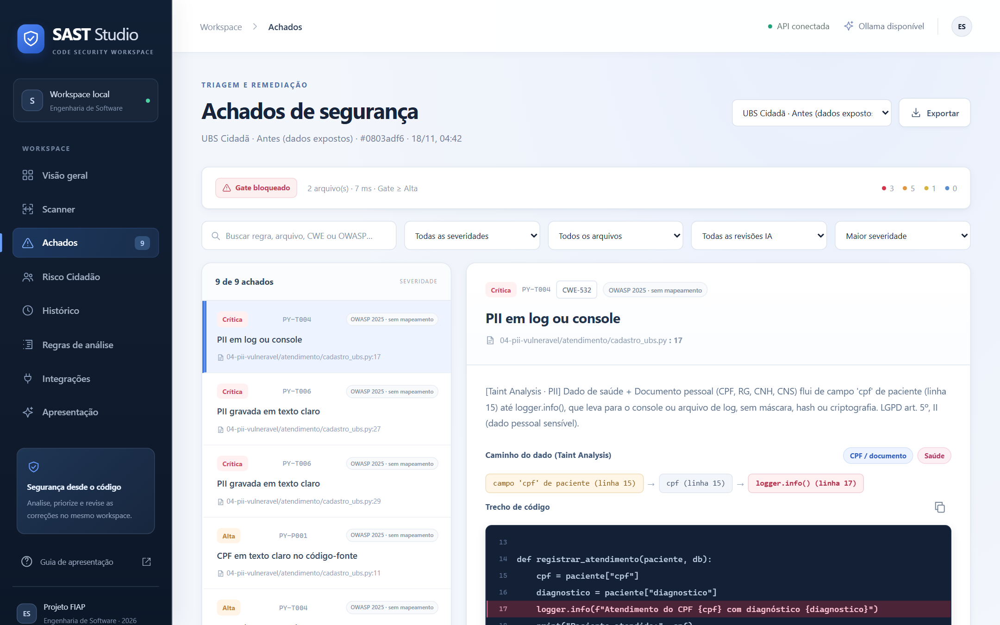
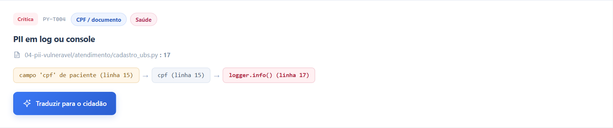
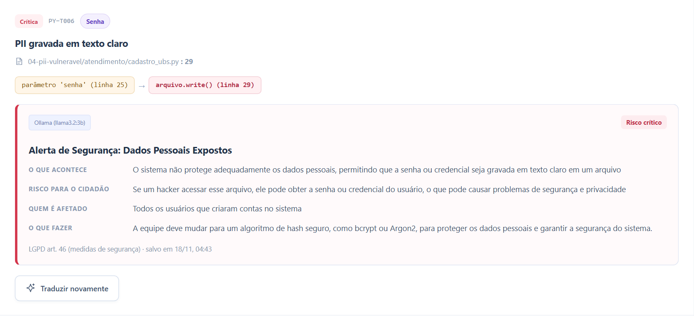
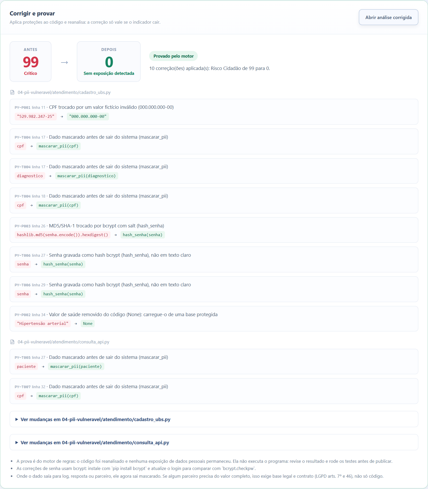

# Entrega · GS CitizenTech · Cybersecurity (Missão Técnica)

Projeto: **SAST Studio**, atualizado com privacidade do cidadão (LGPD): regras de PII, Taint Analysis, IA nos alertas e o indicador **Risco Cidadão**.
Todos os dados de exemplo (CPF, cartões, diagnósticos) são fictícios.

## O que o enunciado pede e onde está

| Entrega | Onde está |
| --- | --- |
| **Código do novo módulo** com as regras PII | [`engine/pii.py`](engine/pii.py), [`engine/rules/pii_rule.py`](engine/rules/pii_rule.py), [`engine/rules/pii_taint_rule.py`](engine/rules/pii_taint_rule.py), [`engine/citizen_risk.py`](engine/citizen_risk.py), [`engine/citizen_alert.py`](engine/citizen_alert.py), [`engine/citizen_fix.py`](engine/citizen_fix.py) |
| **Auditoria do protótipo**: Taint Analysis em ação | [`docs/evidencias/AUDITORIA_TAINT_PII.md`](docs/evidencias/AUDITORIA_TAINT_PII.md) e os prints 03 e 06 abaixo |
| **Dashboard atualizado**: vídeo e print do painel gerando o Risco Cidadão | Vídeo [`docs/video/SAST_Studio_GS_CitizenTech.mp4`](docs/video/SAST_Studio_GS_CitizenTech.mp4) (3min05 em 1080p, voz do Gemini; roteiro em [`docs/video/ROTEIRO.md`](docs/video/ROTEIRO.md)) e prints 04, 05 e 10 abaixo |
| Regras do grupo: uso de IA | [`prompts.md`](prompts.md) |

## Como a nota de cada parte é atendida

| Parte | Peso | O que foi feito | Prova |
| --- | ---: | --- | --- |
| Mapeamento de PII | 3,0 | 6 regras de valor em Python (`PY-P001` a `PY-P006`: CPF, saúde, senha com MD5/SHA-1, CNS, cartão, e-mail/telefone), com as de CPF, saúde, CNS e cartão também em JavaScript e Java. Valida pelo **valor** (dígitos verificadores do CPF e do CNS, Luhn do cartão, DDD do telefone), ignora CPF fictício e cartões de teste | [`tests/test_pii_rules.py`](tests/test_pii_rules.py), [`tests/test_pii_extended.py`](tests/test_pii_extended.py), [`docs/BENCHMARK.md`](docs/BENCHMARK.md) (89 casos, 40 controles seguros) |
| Taint Analysis | 3,0 | 4 regras de fluxo (`PY-T004` a `PY-T007`). Rastreia o dado de uma **fonte** (campo, chave, parâmetro, `input()`) até uma **saída insegura** (log, resposta HTTP, banco ou arquivo, serviço externo), reconhece máscara e hash como sanitização e mostra o caminho passo a passo | [`tests/test_pii_taint.py`](tests/test_pii_taint.py), [auditoria](docs/evidencias/AUDITORIA_TAINT_PII.md) |
| IA na remediação | 2,0 | O Llama 3.2 (Ollama, local) traduz a falha em alerta para o cidadão. **O risco vem da gravidade do achado, não do modelo**; um validador recusa jargão, código, afirmação de vazamento e conselho de hash fraco; há retry e um fallback identificado. Também **corrige o código e prova** (99 → 0) | [`tests/test_citizen_risk.py`](tests/test_citizen_risk.py), [`tests/test_citizen_fix.py`](tests/test_citizen_fix.py), prints 07 e 08 |
| Dashboard Risco Cidadão | 2,0 | Indicador 0–100 com fórmula explicada (`100·(1−e^(−pontos/25))`), gate de segurança, o que mais pesa, caminho do dado, antes/depois e histórico | prints 04, 05, 10 e 11 |

## Prints (tela real do dashboard, dados fictícios)

### Risco Cidadão: antes e depois

| Antes · 99/100 Crítico, gate bloqueado | Depois · 0/100, gate aprovado |
| --- | --- |
|  |  |

Página completa com todos os painéis: [05-risco-cidadao-pagina-completa.png](docs/evidencias/prints/05-risco-cidadao-pagina-completa.png).

### Taint Analysis em ação





### IA em linguagem simples (Ollama `llama3.2:3b`)



### Corrigir e provar (99 → 0)



### Demais prints

| Print | Arquivo |
| --- | --- |
| Visão geral | [01-visao-geral.png](docs/evidencias/prints/01-visao-geral.png) |
| Scanner com a UBS fictícia carregada | [02-scanner-ubs-carregada.png](docs/evidencias/prints/02-scanner-ubs-carregada.png) |
| Diff da correção | [09-diff-da-correcao.png](docs/evidencias/prints/09-diff-da-correcao.png) |
| Evolução antes e depois | [11-evolucao-antes-e-depois.png](docs/evidencias/prints/11-evolucao-antes-e-depois.png) |
| Regras de PII e Taint no catálogo | [12-regras-de-pii-e-taint.png](docs/evidencias/prints/12-regras-de-pii-e-taint.png) |

## Como rodar e conferir

```powershell
pip install -r requirements.txt
python -m pytest -q                                   # 230 testes
python cli.py scan demonstracao/04-pii-vulneravel --fail-on HIGH   # código de saída 1 (9 achados)
python cli.py scan demonstracao/05-pii-corrigido --fail-on HIGH    # código de saída 0
python iniciar.py                                     # dashboard em http://127.0.0.1:8000/dashboard
```

Para a IA de verdade: instale o [Ollama](https://ollama.com), rode `ollama pull llama3.2:3b` e deixe o app aberto. Sem ele, os alertas saem
do motor determinístico e aparecem marcados como **"Motor determinístico (Fallback)"**.
Roteiro passo a passo da demonstração: [`docs/GS_CYBERSECURITY.md`](docs/GS_CYBERSECURITY.md).

## Limites (descritos com honestidade)

- O Risco Cidadão mede **risco encontrado no código**, não prova que um vazamento aconteceu.
- A prova do "Corrigir e provar" vem das regras do motor (o código é reanalisado). Ela não executa o programa: revise e rode os testes antes de publicar.
- O Taint Analysis de PII é para Python e dentro de um arquivo. JavaScript e Java têm as regras de literal (CPF, saúde, CNS, cartão).
- Um modelo local de 3B escreve texto simples e às vezes genérico; por isso o validador e o fallback existem.
