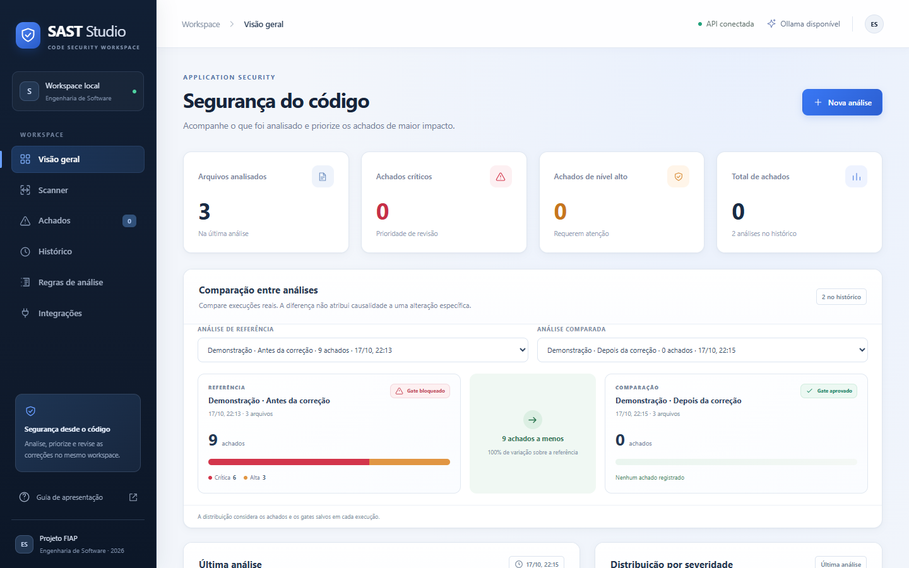
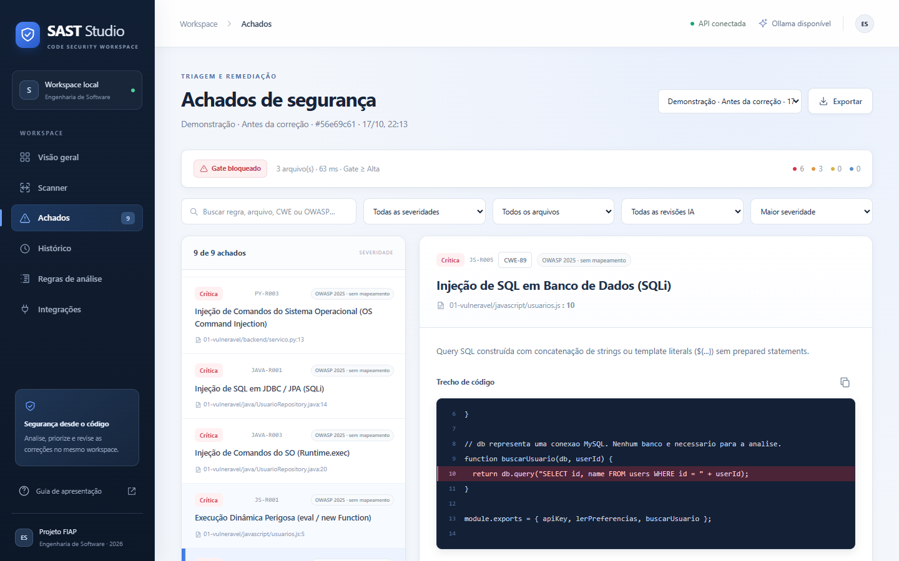
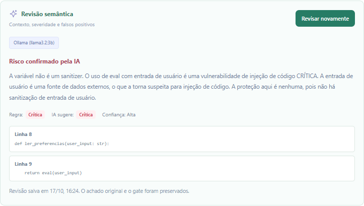
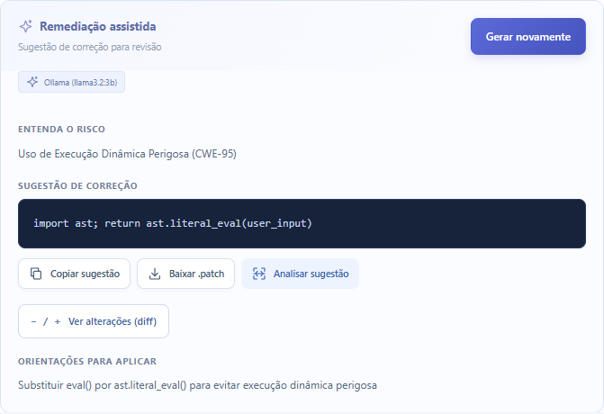
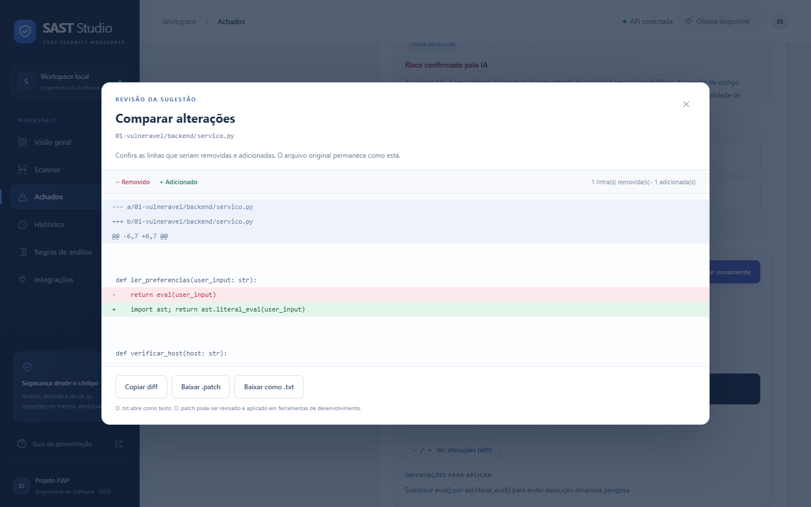
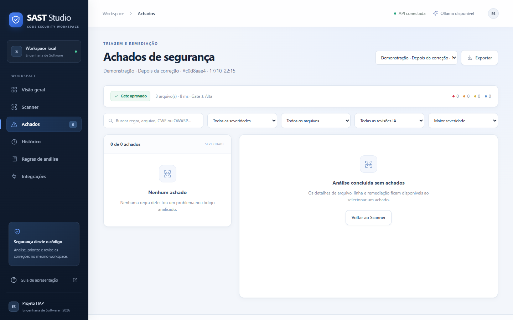
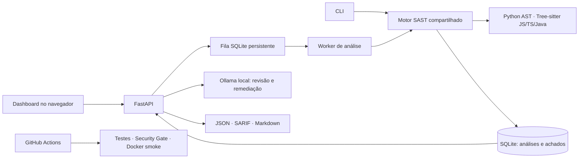

# SAST Studio

Workspace de análise estática de segurança de código feito como projeto acadêmico de Engenharia de Software — FIAP, entrega CP3. O SAST Studio encontra padrões de risco sem executar o código, organiza os resultados no histórico, aplica uma política de bloqueio e oferece revisão e remediação assistidas por IA local.

**Versão 3.0.0 · Python · JavaScript/TypeScript · Java · Ollama · Docker · GitHub Actions**

<p align="center">
  
</p>

<p align="center"><em>Visão geral real do sistema: comparação entre 9 achados bloqueantes e uma análise corrigida com 0 achados pelas regras atuais.</em></p>

## Demonstração em imagens

As capturas abaixo foram feitas na interface local do projeto. A análise de IA mostrada foi retornada pelo Ollama com o modelo `llama3.2:3b`; não é uma resposta escrita para ilustrar a tela.

| Fluxo | Captura |
| --- | --- |
| Projeto vulnerável: achados e gate bloqueado |  |
| Revisão semântica real: risco confirmado e evidências |  |
| Remediação sugerida pelo Ollama (`llama3.2:3b`) |  |
| Diff com linhas removidas e adicionadas |  |
| Projeto corrigido: zero achados atuais e gate aprovado |  |

> As telas demonstram exemplos controlados incluídos no repositório. Zero achados quer dizer que as regras aplicadas não encontraram os padrões cobertos; isso não comprova segurança absoluta.

## O que o sistema faz

- Analisa arquivos, pastas e trechos de código com regras estruturais e análise de fluxo Python básica.
- Envia trabalhos para uma fila persistente, acompanha o worker e guarda execuções e revisões em SQLite.
- Aplica um gate configurável para aprovar ou bloquear uma análise conforme a severidade dos achados.
- Exibe evidências por regra, CWE, arquivo, linha, contexto e categoria OWASP Top 10:2025 quando há mapeamento documentado.
- Usa Ollama local para contextualizar achados e sugerir correções. A IA não altera os arquivos automaticamente nem decide o gate original.
- Reanalisa uma sugestão e mostra o diff antes de qualquer aplicação manual.
- Exporta resultados em JSON, SARIF e Markdown.
- Oferece dashboard com gráficos, histórico e comparação de execuções salvas.
- Inclui CLI, API, Docker Compose e GitHub Actions para validar alterações em Pull Requests.

## Fluxo demonstrável

1. Em **Scanner**, carregue a pasta vulnerável de demonstração e execute a análise.
2. Abra **Achados**: o exemplo tem 3 arquivos e 9 achados (6 críticos e 3 altos); o gate fica bloqueado pelo limiar `HIGH`.
3. Selecione `PY-R001` e use **Revisar com IA**. Confira o selo `Ollama (llama3.2:3b)`, a avaliação, a confiança e as evidências.
4. Gere uma remediação e abra **Ver alterações (diff)**. Revise o patch; **Analisar sugestão** verifica estaticamente o código proposto.
5. Carregue o projeto corrigido e rode outra análise. São 3 arquivos, 0 achados pelas regras atuais e gate aprovado.
6. Em **Visão geral**, compare as duas execuções salvas. Em **Histórico**, reabra resultados e exporte os relatórios.

Os exemplos vulnerável e corrigido são propositalmente pequenos e não executam as funções vulneráveis. Para demonstrar a IA, mostre o identificador do provedor na própria interface; uma resposta do **Motor determinístico (Fallback)** não é uma inferência do LLM.

## Arquitetura



No modo local, a API inicia um worker embutido para facilitar o uso no Windows. No Docker, a API e os workers são serviços separados que compartilham um volume persistente. A fila SQLite atende uma instalação em um host; não é um broker distribuído entre vários servidores.

## Linguagens e cobertura

| Linguagem | Técnica | Observação |
| --- | --- | --- |
| Python (`.py`) | AST nativa e análise básica de fluxo de dados | A cobertura de fluxo é limitada; não há análise completa entre arquivos. |
| JavaScript/TypeScript (`.js`, `.jsx`, `.ts`, `.tsx`) | AST Tree-sitter e regras estruturais | Gramáticas JS, TS e TSX. |
| Java (`.java`) | AST Tree-sitter e regras estruturais | A análise não substitui compilação ou resolução de tipos/dependências. |

O catálogo pode ser consultado na tela **Regras de análise** ou por `python cli.py rules`. As regras disponíveis abrangem, conforme linguagem, execução dinâmica, segredos, comandos, SQL Injection, XSS, SSRF e operações inseguras com arquivos. O mapeamento CWE → OWASP Top 10:2025 só é exibido para categorias cobertas por vínculo documentado; os demais CWEs aparecem sem mapeamento.

## Instalação no Windows

### Pré-requisitos

- Windows 10 ou 11 e Python 3.11 instalado.
- Ollama instalado e o modelo `llama3.2:3b` baixado para habilitar a IA local.
- Internet necessária na primeira instalação e para acessar o GitHub. Depois de instalar dependências e baixar o modelo, a análise local pode funcionar sem internet.

### Preparar e iniciar

```powershell
git clone https://github.com/vinycius11dev/sast-studio-cp3.git
cd sast-studio-cp3
py -3.11 -m pip install -r requirements.txt
ollama pull llama3.2:3b
ollama list
```

Abra o aplicativo Ollama, depois dê dois cliques em **`iniciar.bat`** ou execute:

```powershell
python iniciar.py
```

O navegador abre o workspace em <http://127.0.0.1:8000/dashboard>. Mantenha a janela do servidor aberta. A documentação interativa da API fica em <http://127.0.0.1:8000/docs>; a verificação de saúde fica em <http://127.0.0.1:8000/health>.

Antes da apresentação, execute **`verificar_apresentacao.bat`** com o servidor e o Ollama abertos. Ele percorre os fluxos vulnerável/corrigido, confere os relatórios e exige duas inferências reais quando usa `--require-llm`. O resumo é gravado em `reports/smoke-result.json`, pasta local ignorada pelo Git.

### Sem Ollama

O scanner estático continua disponível. A revisão e a remediação por modelo ficam indisponíveis ou usam o fallback determinístico, identificado na interface. Para demonstrar que a IA está funcionando, instale/abra Ollama, confirme `ollama list` e mostre que a resposta indica `Ollama (llama3.2:3b)`.

## Uso pela linha de comando

```powershell
python cli.py rules
python cli.py scan ./samples/vulnerable_sample.py --fail-on HIGH
python cli.py scan ./samples/secure_sample.py --fail-on HIGH
python cli.py scan ./samples -f sarif -o sast-results.sarif --fail-on HIGH
python cli.py scan ./samples/vulnerable_sample.py --ai -f json -o resultado.json
```

| Código de saída | Significado |
| --- | --- |
| `0` | Análise concluída sem achados bloqueantes. |
| `1` | Foram encontrados achados no limiar ou acima dele. |
| `2` | Erro de leitura, sintaxe ou processamento incompleto. Erros não aprovam o gate. |

A API e a CLI compartilham a política de gate. O padrão da API é `HIGH`; use `--fail-on HIGH` na CLI para aplicar a mesma política. JSON e SARIF podem incluir as revisões semânticas quando a opção de IA for usada.

## API

Rotas principais sob `/api/v1`:

| Rota | Uso |
| --- | --- |
| `POST /scan/code`, `POST /scan/file`, `POST /scan/project` | Analisar trecho, arquivo ou projeto. |
| `GET /scans` e `GET /scans/{id}` | Listar o histórico e reabrir uma análise. |
| `GET /scans/{id}/source` | Consultar fontes guardadas para aquela análise. |
| `GET /scans/{id}/report` | Exportar o resultado selecionado. |
| `/remediate` | Gerar uma sugestão assistida. |
| `/ai/status` | Consultar a disponibilidade do serviço e do modelo. |
| `/rules` | Consultar o catálogo de regras. |

Para os contratos e os exemplos de payload, execute a aplicação e abra `/docs`.

## IA local e configurações

O serviço usa Ollama local. Uma análise estática produz os achados; o LLM faz triagem contextual e sugere uma possível remediação. As respostas são consultivas, podem estar incorretas e não removem achados nem mudam o gate original. A geração pode demorar mais na primeira chamada enquanto o modelo carrega. Respostas em formato inválido recebem uma tentativa adicional dentro do limite total.

| Variável | Padrão |
| --- | --- |
| `OLLAMA_BASE_URL` | `http://localhost:11434` |
| `OLLAMA_MODEL` | `llama3.2:3b` |
| `OLLAMA_REQUEST_TIMEOUT` | 90 segundos |
| `OLLAMA_KEEP_ALIVE` | `30m` |
| `SAST_DATA_DIR` | `./data` |
| `SAST_EMBEDDED_WORKER` | `1` local; `0` nos serviços Docker |
| `SAST_PORT` | `8000` |
| `ALLOWED_ORIGINS` | localhost e 127.0.0.1 na porta 8000 |

Limites de entrada: 200 arquivos por projeto, 25 MB por projeto e 5 MB por arquivo. Dependências, caches e diretórios de build são ignorados. O conteúdo analisado não é executado. O histórico local fica em `data/scans.sqlite3` e a fila em `data/jobs.sqlite3`; esses dados são ignorados pelo Git.

## Docker

Docker é opcional para rodar o workspace no Windows. Use-o para demonstrar o serviço conteinerizado e os workers separados:

```powershell
docker compose up --build
docker compose up -d --scale sast-worker=2
docker compose --profile cli run --rm sast-cli-runner scan /app/samples --fail-on HIGH
```

O contêiner executa sem root e o volume `sast-data` preserva o histórico. Para um Ollama no host, o Compose usa `host.docker.internal:11434`; altere `OLLAMA_BASE_URL` se o serviço estiver em outro endereço.

## GitHub Actions

O repositório público é [vinycius11dev/sast-studio-cp3](https://github.com/vinycius11dev/sast-studio-cp3). O workflow `.github/workflows/sast_security_gate.yml` executa os testes Python/JavaScript, benchmark e auditoria do motor, e roda o Docker smoke da API, fila e relatórios. Os resultados ficam nos logs, resumo e artifacts da execução. Com os checks **Security Gate** e **Docker smoke** configurados como obrigatórios, um Pull Request vulnerável pode falhar e um corrigido pode passar antes do merge.

Esta entrega já mantém exemplos reais de Pull Requests: [PR #1 vulnerável](https://github.com/vinycius11dev/sast-studio-cp3/pull/1) e [PR #2 corrigido](https://github.com/vinycius11dev/sast-studio-cp3/pull/2). Consulte [as evidências da entrega](docs/GITHUB_CP3.md). Publicar o código não hospeda o dashboard: a interface roda localmente ou em um servidor que você configurar.

## Testes e verificações

```powershell
python -m pytest -q -W error::pytest.PytestUnhandledThreadExceptionWarning
node --check static/js/dashboard.js
node --test tests/diff-viewer.test.cjs
python -m scripts.benchmark --output reports/benchmark.json --markdown reports/benchmark.md
python -m scripts.smoke
python -m scripts.smoke --require-llm
```

Inicie primeiro o app com `iniciar.bat`. `python -m scripts.smoke` valida API, worker, exemplos vulnerável/corrigido, gates e formatos de relatório, sem chamar o LLM. `python -m scripts.smoke --require-llm` também faz inferências reais de triagem e remediação e falha se retornar fallback.

Na revalidação local de 18/10/2026: 95 testes Python aprovados; 4 testes Node aprovados; smoke com 9 achados/bloqueado contra 0/aprovado; e triagem/remediação reais por Ollama. O corpus interno tem 53 casos, incluindo 24 controles seguros: obteve precisão e recall de 100% nessa amostra delimitada. Isso não é uma avaliação independente nem garante os mesmos resultados em qualquer projeto. Docker e persistência entre reinícios foram validados em execução anterior, conforme detalhado em [VALIDACAO.md](docs/VALIDACAO.md).

## Limites conhecidos

- A cobertura depende das regras atuais e da linguagem. Fluxo de dados Python é básico; a análise entre arquivos não é completa.
- Tree-sitter analisa estrutura sintática e não substitui compilação nem resolução de tipos e dependências.
- Uma análise com zero achados não prova que o projeto é seguro. Revise resultados e correções antes de aplicá-los.
- A IA pode errar e não toma decisões automáticas sobre o gate.
- SQLite atende o uso local ou de um host. Autenticação multiusuário e distribuição entre hosts não estão implementadas.

## Documentação da entrega

- [Roteiro de apresentação e perguntas para a defesa](docs/APRESENTACAO.md)
- [Arquitetura do sistema](docs/c4_model.md)
- [Aderência ao enunciado](docs/ADERENCIA_AO_ENUNCIADO.md)
- [Validação, resultados e limites](docs/VALIDACAO.md)
- [Benchmark e corpus rotulado](docs/BENCHMARK.md)
- [Demonstração passo a passo](demonstracao/LEIA-ME.md)
- [Evidências dos Pull Requests e Actions](docs/GITHUB_CP3.md)

As credenciais nos projetos de exemplo são fictícias. O repositório público não inclui banco local, arquivos enviados por usuários ou o PDF do enunciado.
