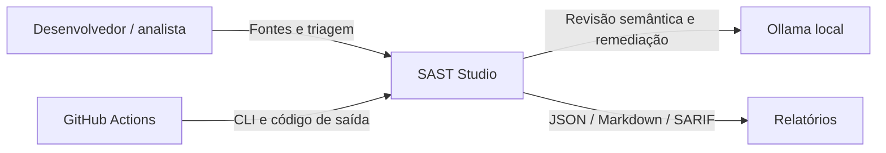
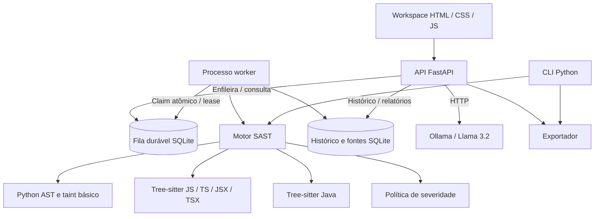
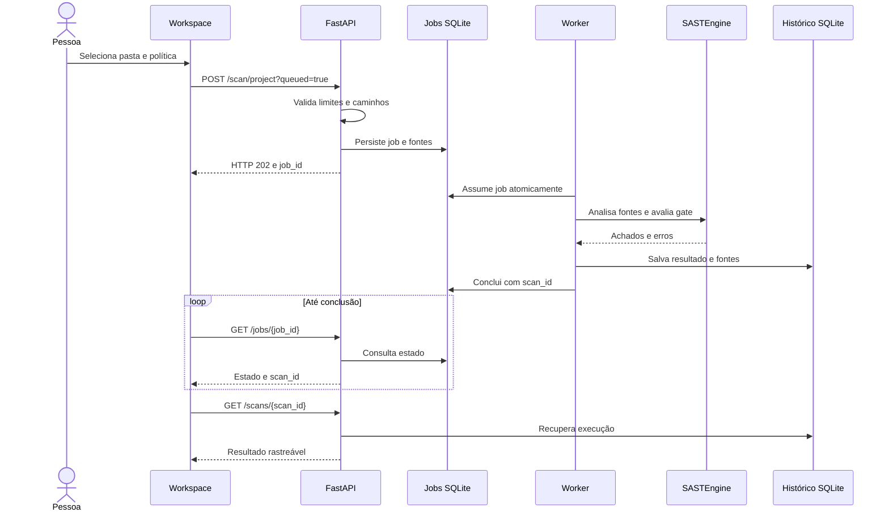

# Arquitetura em execução — SAST Studio 3.0

## C1 — Contexto

## C2 — Containers e armazenamento

O Compose executa API e worker em processos e containers separados, com volume
compartilhado. O inicializador local usa um worker embutido para simplificar a
instalação. A fila persiste jobs, usa transação para impedir dois workers de
assumirem o mesmo job, heartbeat e recuperação de lease expirado (até 3 tentativas).
A instalação aceita vários workers no mesmo host; não implementa broker Redis
nem uma fila distribuída entre hosts.

## C3 — Módulos

| Módulo | Responsabilidade |
| --- | --- |
| api/main.py | Validação, upload, jobs, histórico, triagem e relatórios |
| api/jobs.py | Fila durável, claim atômico, lease e heartbeat |
| api/worker.py | Consumo de jobs, execução e persistência |
| api/store.py | Fontes, resultados e revisões de IA em SQLite |
| engine/engine.py | Roteamento por linguagem e consolidação |
| engine/languages/ e rules/ | AST, regras e fluxo básico de dados |
| engine/policy.py | Decisão passed / blocked / error |
| engine/semantic_review.py | Classificação contextual, evidências e validação do LLM |
| engine/ai_remediation.py | Ollama, validação de sugestões e fallback identificado |
| engine/reporter.py | JSON, Markdown e SARIF da análise selecionada |
| static/js/dashboard.js | Upload, acompanhamento, filtros, IA e downloads |

## Visão dinâmica — análise assíncrona

## Decisões e limites

O upload não executa código. Erros de parsing impedem a aprovação. A IA recebe
o contexto armazenado do achado, pode sugerir severidade e possível falso positivo,
e registra justificativa, linhas de evidência e modelo. A recomendação não apaga
o resultado original nem altera silenciosamente o gate. Falhas são identificadas.

SQLite atende a demonstração em um host. Autenticação multiusuário, distribuição
entre hosts e fluxo completo entre arquivos não estão implementados. Tree-sitter
valida a estrutura sintática; não substitui compilação ou testes da aplicação alvo.
